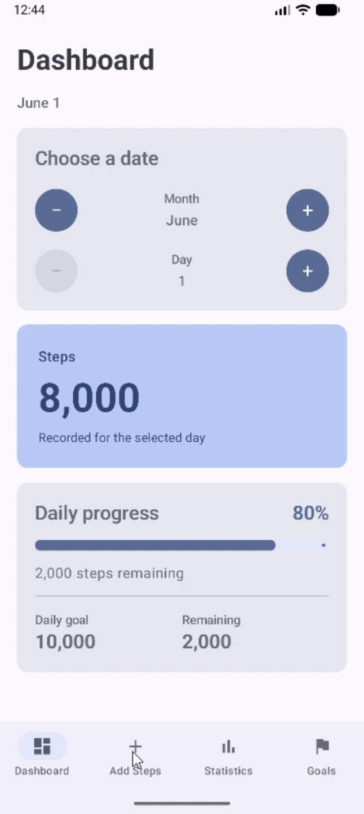
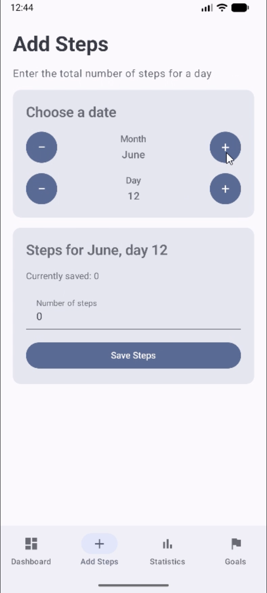
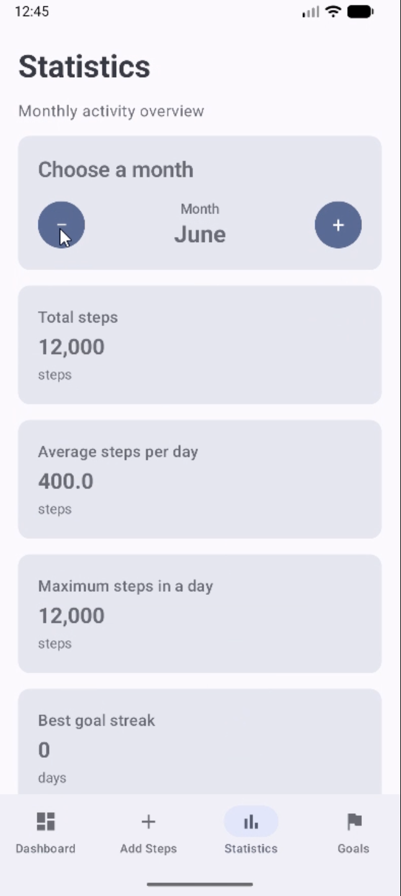
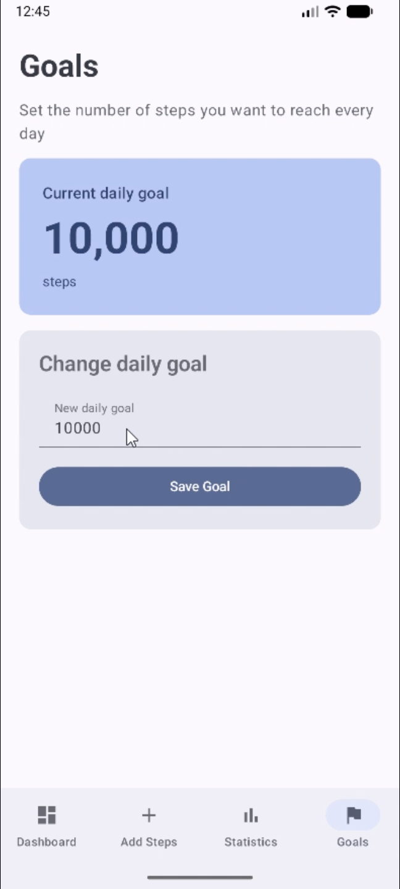

# Step Tracker Android

Step Tracker Android is an educational Android application for recording daily
steps and reviewing monthly activity. It is built with Kotlin and Jetpack
Compose as an Android adaptation of the original
[Java Step Tracker](https://github.com/shevlyagin/Java-Step-Tracker) project.

The project focuses on clear business logic, basic reactive Compose state, and
a small structure that is easy to understand and extend.

## Demo

**[Watch the Step Tracker Android demo on YouTube](https://youtube.com/shorts/W0r64to347A)**

## Features

- **Dashboard** — view the steps recorded for a selected day, the current daily
  goal, completion percentage, progress indicator, and remaining steps.
- **Add Steps** — select a month and day, enter a step count, and replace a
  previously saved value.
- **Statistics** — review monthly totals, daily average, maximum daily steps,
  best goal streak, estimated distance, and estimated calories burned.
- **Goals** — view and update the daily step goal.
- Navigate between all four screens with a Material 3 bottom navigation bar.
- Display month names and numbers consistently, using the device locale for
  numeric formatting.

## Technologies

- Kotlin
- Jetpack Compose
- Material 3
- Navigation3
- Kotlin Serialization for navigation keys
- Basic Compose state with `remember` and `mutableStateOf`
- Gradle Kotlin DSL
- JUnit 4 for local unit tests

The application does not use ViewModel, Room, DataStore, Retrofit, dependency
injection, or third-party architecture libraries.

## Architecture

The project uses a deliberately small structure rather than a named
architecture pattern:

```text
app/src/main/java/com/shevlyagin/steptracker/
├── MainActivity.kt
├── StepTrackerState.kt
├── model/
│   ├── StepCalculator.kt
│   └── StepTracker.kt
├── navigation/
│   ├── NavigationWrapper.kt
│   └── Routes.kt
└── ui/
    ├── AddStepsScreen.kt
    ├── DashboardScreen.kt
    ├── GoalsScreen.kt
    ├── StatisticsScreen.kt
    ├── UiFormatting.kt
    └── theme/
```

- **`model`** contains step storage, input rules, and calculations. It has no
  dependency on the user interface.
- **`StepTrackerState`** owns the shared in-memory model and exposes observable
  Compose state. A single instance is shared by all screens.
- **`ui`** contains screen composables that receive application data and
  callbacks, plus local input state, formatting, and the Material 3 theme.
- **`navigation`** defines serializable Navigation3 route keys, the navigation
  back stack, and the bottom navigation bar.
- **`app/src/test`** contains local JVM unit tests for the model, calculations,
  shared state, input validation, formatting, and navigation stack behavior.

## Running the App

### Requirements

- A recent Android Studio version compatible with Android Gradle Plugin 9.2.1
  and Gradle 9.4.1
- Android SDK Platform 37.1 installed
- An emulator or Android device running Android 7.0 (API 24) or newer

### Steps

1. Clone the repository:

   ```bash
   git clone https://github.com/shevlyagin/Step-Tracker-Android.git
   ```

2. Open the cloned project directory in Android Studio.
3. Allow Android Studio to complete the Gradle sync and install any requested
   SDK components.
4. Select an emulator or connected Android device.
5. Run the `app` configuration.

To create a Debug APK from the command line, run:

```bash
bash ./gradlew assembleDebug
```

On Windows, use `gradlew.bat assembleDebug`.

## Unit Tests

The local unit tests cover:

- storing, replacing, and validating daily step values;
- daily goal validation and updates;
- monthly total, average, maximum, and best-streak calculations;
- distance and calorie conversions;
- updates exposed through `StepTrackerState`;
- input validation for the Add Steps and Goals screens;
- locale-aware number formatting and month names;
- navigation history and duplicate-route prevention.

Run all local unit tests with:

```bash
bash ./gradlew testDebugUnitTest
```

On Windows, use `gradlew.bat testDebugUnitTest`.

## Screenshots

<table>
  <tr>
    <td align="center">
      <strong>Dashboard</strong><br>
      
    </td>
    <td align="center">
      <strong>Add Steps</strong><br>
      
    </td>
  </tr>
  <tr>
    <td align="center">
      <strong>Statistics</strong><br>
      
    </td>
    <td align="center">
      <strong>Goals</strong><br>
      
    </td>
  </tr>
</table>

## Current Limitations

- All data is stored only in memory. It is not retained after the application
  process ends and may also reset if the activity is recreated.
- The learning model uses 12 months with exactly 30 days in each month.
- Steps are entered manually; Android sensors and Health Connect are not used.
- The application has no server integration or database.
- The distance and calorie values are estimates based on the formulas preserved
  from the original Java project.

## Original Project

This application is the Android version of
[Java-Step-Tracker](https://github.com/shevlyagin/Java-Step-Tracker). It preserves
the original project's simplified calendar model and core calculation rules
while presenting them through a Jetpack Compose interface.
